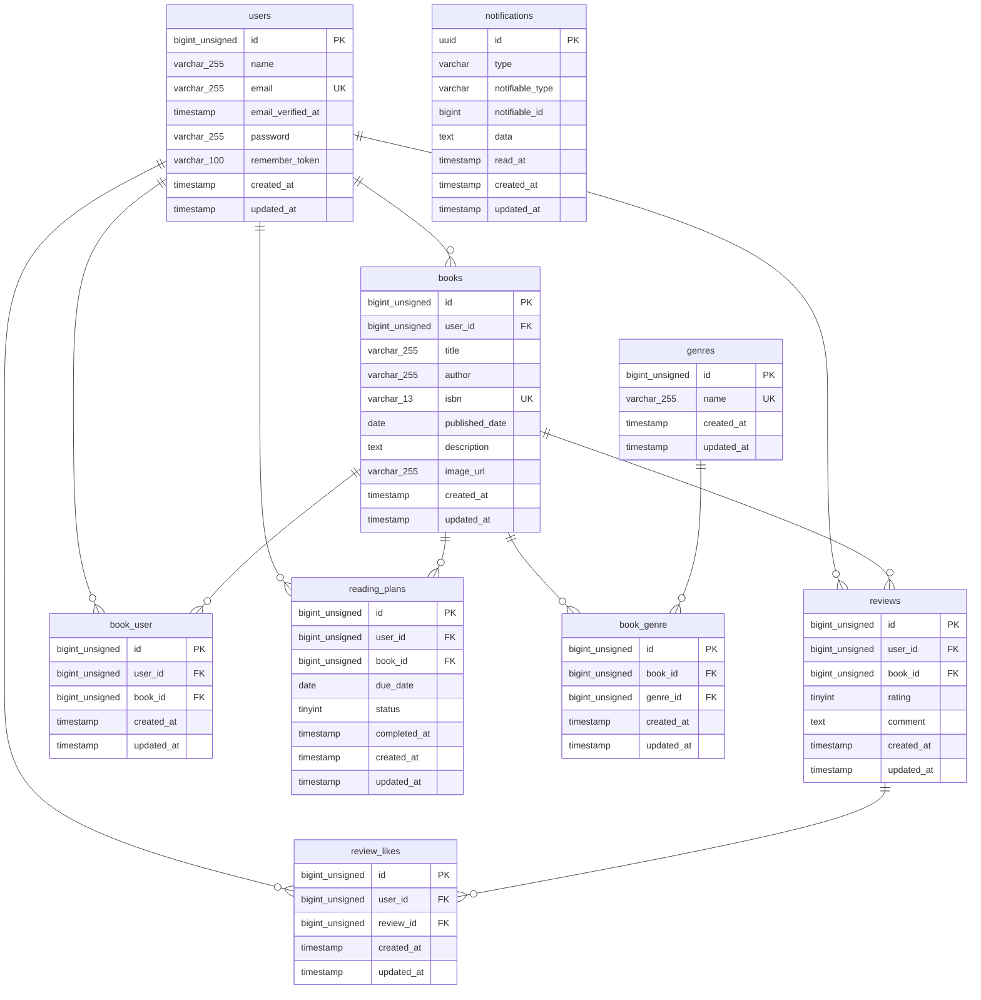

# BookShelf - 書籍レビューアプリ

## 1. アプリケーション概要

BookShelfは、書籍の登録・検索・レビュー・お気に入り管理などができる書籍レビューアプリケーションです。

ユーザーが書籍情報を登録し、レビューや評価を投稿することで、ほかのユーザーと書籍の感想を共有できます。

また、読書計画や通知機能を実装し、読書の進捗管理もできるようにしています。

本プロジェクトでは、Laravelを使用したバックエンド開発を中心に、基本機能からAPI連携、認証、通知処理まで実装しています。

## 2. 作成者

- 氏名：木下真理
- GitHub：https://github.com/kino-mari/bookshelf-app

## 3. 使用技術

| 分類           | 技術                                      |
| -------------- | ----------------------------------------- |
| 言語           | PHP 8.5                                   |
| フレームワーク | Laravel 10                                |
| データベース   | MySQL 8.4                                 |
| 開発環境       | Docker / Laravel Sail                     |
| フロントエンド | Blade / Tailwind CSS / Alpine.js          |
| ビルドツール   | Vite                                      |
| API認証        | Laravel Sanctum                           |
| 外部API        | Google Books API                          |
| 通知           | Laravel Notifications（Database Channel） |
| キュー         | Laravel Queue（Database）                 |
| DB管理         | phpMyAdmin                                |
| テスト         | PHPUnit / Laravel Feature Test            |

## 4. アプリケーション構成

本アプリケーションは、WebアプリケーションとJSON APIの2つの構成で開発しています。

### Webアプリケーション

- Bladeを使用した画面表示
- Laravelのセッション認証
- `routes/web.php` にルートを定義
- Controllerを通じたデータ処理

### API

- JSON形式で書籍情報を提供
- `routes/api.php` にルートを定義
- API専用Controllerを使用（`app/Http/Controllers/Api/V1/`）
- Laravel Sanctumによるトークン認証
- BookPolicyによる書籍の更新・削除権限管理

## 5. ER図（データベース設計）



### 主なテーブルの役割

| テーブル名    | 役割                               |
| ------------- | ---------------------------------- |
| users         | ユーザー情報                       |
| books         | 書籍情報                           |
| genres        | ジャンル情報                       |
| reviews       | 書籍レビュー                       |
| book_genre    | 書籍とジャンルの中間テーブル       |
| book_user     | お気に入りの中間テーブル           |
| review_likes  | レビューへのいいねの中間テーブル   |
| reading_plans | 読書計画                           |
| notifications | ポリモーフィック関連による通知情報 |

※Laravel標準の管理用テーブルや、Sanctumの `personal_access_tokens` などはER図から省略しています。

## 6. 環境構築

### 6-1. リポジトリをクローン

```bash
git clone https://github.com/kino-mari/bookshelf-app.git
cd bookshelf-app
```

### 6-2. 環境設定ファイルを作成

```bash
cp .env.example .env
```

`.env` のデータベース設定を以下のように変更します。

```env
APP_NAME=Laravel
APP_ENV=local
APP_DEBUG=true
APP_URL=http://localhost

DB_CONNECTION=mysql
DB_HOST=mysql
DB_PORT=3306
DB_DATABASE=laravel
DB_USERNAME=sail
DB_PASSWORD=password

QUEUE_CONNECTION=database
SESSION_DRIVER=file
CACHE_DRIVER=file
```

※ `APP_KEY` は後の手順で生成します。実際の `.env` ファイルはGitHubに公開しないでください。

### 6-3. Composerパッケージをインストール

Composerを使用して、必要なPHPパッケージをインストールします。

```bash
docker run --rm \
  -u "$(id -u):$(id -g)" \
  -v "$(pwd):/var/www/html" \
  -w /var/www/html \
  laravelsail/php82-composer:latest \
  composer install
```

※ composer.lock に記録されたバージョンに基づいてパッケージをインストールします。

### 6-4. Laravel Sailを起動

```bash
./vendor/bin/sail up -d
```

以降の操作を簡単にするため、エイリアスを設定します。

```bash
alias sail='[ -f sail ] && bash sail || bash vendor/bin/sail'
```

### 6-5. アプリケーションキーを生成

```bash
sail artisan key:generate
```

### 6-6. データベースのマイグレーションと初期データ登録

```bash
sail artisan migrate --seed
```

初期データには以下が登録されます。

- ユーザー
- ジャンル
- 書籍
- レビュー
- お気に入り
- レビューへのいいね
- 読書計画

データベースを初期化して再作成する場合は、以下を実行します。

```bash
sail artisan migrate:fresh --seed
```

※既存のデータはすべて削除されます。

### 6-7. フロントエンドの依存パッケージをインストール

```bash
sail npm install
```

フロントエンドの開発サーバーを起動します。

```bash
sail npm run dev
```

### 6-8. 日本語設定

`config/app.php` のロケール設定を変更します。

```php
'locale' => 'ja',
```

日本語のバリデーションメッセージなどを利用するため、`lang/ja` の言語ファイルを配置しています。

## 7. 開発環境へのアクセス

- アプリケーション：http://localhost
- phpMyAdmin：http://localhost:8080

### データベース接続情報

| 項目           | 設定値   |
| -------------- | -------- |
| ホスト         | mysql    |
| ポート         | 3306     |
| データベース名 | laravel  |
| ユーザー名     | sail     |
| パスワード     | password |

## 8. 初期ログイン情報

`DatabaseSeeder` を実行すると、動作確認用のユーザーが5人登録されます。

**共通パスワード：** `password`

| 名前     | メールアドレス        |
| -------- | --------------------- |
| 山田太郎 | yamada@example.com    |
| 鈴木花子 | suzuki@example.com    |
| 田中一郎 | tanaka@example.com    |
| 佐藤美咲 | sato@example.com      |
| 高橋健太 | takahashi@example.com |

※開発・動作確認用のアカウントです。本番環境では使用しないでください。

## 9. 実装機能

### 基本機能

| 機能         | 内容                                         |
| ------------ | -------------------------------------------- |
| ユーザー認証 | ユーザー登録・ログイン・ログアウト           |
| 書籍管理     | 書籍の登録・一覧・詳細・編集・削除           |
| ジャンル管理 | ジャンルの登録・編集・削除、書籍との紐付け   |
| レビュー     | 書籍へのレビュー投稿・編集・削除             |
| 評価機能     | 5段階評価、平均評価の表示                    |
| お気に入り   | 書籍のお気に入り登録・解除・一覧表示         |
| いいね       | レビューへのいいね登録・解除                 |
| ランキング   | 書籍の評価ランキング                         |
| 公開API      | 書籍情報のJSON形式での取得・登録・更新・削除 |

### 応用機能

| 機能             | 内容                                     |
| ---------------- | ---------------------------------------- |
| 書籍検索         | キーワードによる書籍検索                 |
| 絞り込み         | ジャンルによる絞り込み                   |
| 並び替え         | 発売日・タイトル・評価などによる並び替え |
| ページネーション | 書籍一覧を10件ずつ表示                   |
| ISBN検索         | Google Books APIを利用した書籍情報の取得 |
| 読書レポート     | 読書状況やレビュー評価などの集計         |
| API認証          | Laravel Sanctumによるトークン認証        |
| 読書計画         | 読書予定日・進捗状況の登録・編集・削除   |
| 通知機能         | 読書計画に関する通知の登録・一覧・既読化 |
| バッチ処理       | 読書計画の状態更新などの定期処理         |

## 10. APIエンドポイント

APIのベースURLは `http://localhost/api/v1` です。

| HTTPメソッド | エンドポイント         | 機能                      | 認証 |
| ------------ | ---------------------- | ------------------------- | ---- |
| POST         | `/api/v1/login`        | APIログイン・トークン発行 | 不要 |
| GET          | `/api/v1/books`        | 書籍一覧取得              | 不要 |
| GET          | `/api/v1/books/{book}` | 書籍詳細取得              | 不要 |
| POST         | `/api/v1/books`        | 書籍登録                  | 必要 |
| PUT          | `/api/v1/books/{book}` | 書籍更新                  | 必要 |
| DELETE       | `/api/v1/books/{book}` | 書籍削除                  | 必要 |

### API認証について

Laravel Sanctumを使用したAPIトークン認証を導入しています。

1. `POST /api/v1/login` にメールアドレスとパスワードを送信します。
2. 認証に成功すると、APIトークンとユーザー情報がJSON形式で返されます。
3. 認証が必要なAPIには、取得したトークンを `Authorization: Bearer {token}` ヘッダーに設定してアクセスします。

書籍一覧・詳細取得は認証不要です。書籍の登録・更新・削除にはトークン認証が必要です。

また、BookPolicyによって書籍の更新・削除は所有者のみ実行できるように制御しています。

### APIログインリクエスト例

```json
{
    "email": "yamada@example.com",
    "password": "password"
}
```

### APIログイン成功時のレスポンス例

```json
{
    "message": "ログインしました。",
    "token": "発行されたAPIトークン",
    "user": {
        "id": 1,
        "name": "山田太郎",
        "email": "yamada@example.com"
    }
}
```

## 11. 通知・バッチ処理

Laravel NotificationsのDatabase Channelを使用し、読書計画に関する通知をデータベースに保存します。

通知機能では、ログインユーザーの通知一覧表示と既読化に対応しています。

### キュー処理

`.env` で以下を設定しています。

```env
QUEUE_CONNECTION=database
```

キューワーカーを起動する場合は、以下を実行します。

```bash
sail artisan queue:work database --tries=3
```

### スケジュール処理

読書計画の状態更新などを毎日午前0時に実行します。

スケジュール処理を起動する場合は、以下を実行します。

```bash
sail artisan schedule:work
```

※キューワーカーとスケジューラーは、必要に応じて別々のターミナルで起動します。

## 12. テスト

Laravelのテスト機能を使用して、機能ごとの動作確認を行います。

### テスト実行

```bash
sail artisan test
```

### カバレッジ確認

```bash
sail artisan test --coverage
```

テストでは、書籍・レビュー・検索・認証・権限などの機能を確認します。

## 13. コード品質・設計方針

以下を意識して実装しています。

- PSR-12およびLaravelのコーディング規約に沿った記述
- Controller、Model、FormRequest、Policyの役割分担
- FormRequestによる入力値のバリデーション
- Policyによる認可処理
- Eloquent ORMを使用したデータ操作
- Eager LoadingによるN+1問題への対応
- Collectionを利用したデータ処理
- DB::transactionによるトランザクション管理
- PHPの型宣言とPHPDocによる可読性の向上
- Laravel Pintによるコード整形

### コード整形

```bash
sail pint
```

## 14. GitHub

- GitHub：https://github.com/kino-mari/bookshelf-app

```

```
